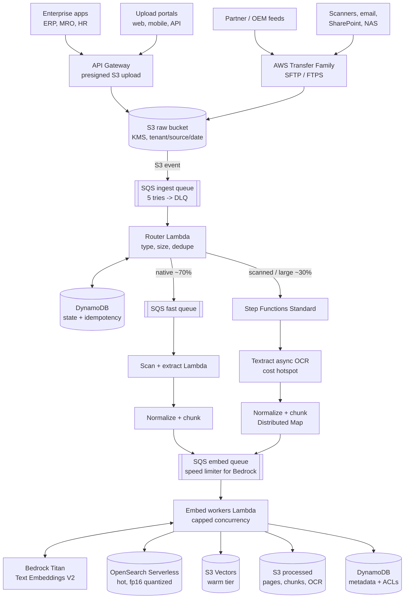

# Serverless Aviation Document Ingestion on AWS (2 million documents/day)

A production-style reference pipeline that turns aviation technical documents (maintenance manuals,
service bulletins, airworthiness directives, MEL, scanned task cards, SOPs) into **searchable,
cited, access-controlled vectors** for RAG and AI agents.

> All documents in `samples/` are synthetic. Registrations, part numbers and procedures are invented.

| Volume | Value |
|---|---|
| Documents | 2,000,000/day = ~23 docs/s average, sized for **5x peak** (~116 docs/s) |
| Chunks | ~20,000,000/day (~10 per document, ~500 tokens each) |
| Embedding tokens | ~10,000,000,000/day |
| Split | ~70% fast lane (born-digital), ~30% heavy lane (scans, very large files) |

## Architecture



Every stage is explained step by step, with an aviation example and the code location, in
**[docs/pipeline-steps.md](docs/pipeline-steps.md)**. Capacity maths and cost:
**[docs/capacity-and-cost.md](docs/capacity-and-cost.md)**. Failure handling, security and DR:
**[docs/design-decisions.md](docs/design-decisions.md)**.

## Repository map

```
src/docingest/
  handlers/presign.py       API Gateway -> scoped presigned S3 POST (tenant from JWT)
  handlers/router.py        S3 event -> claim, sniff, probe, dedupe -> fast queue | Step Functions
  handlers/fast_lane.py     malware gate, native parse, chunk, enqueue (promotes image-heavy PDFs)
  handlers/heavy_lane.py    plan, Textract start (task token), SNS completion, collect, chunk ranges, finalize
  handlers/embed_worker.py  Titan V2 -> OpenSearch + S3 Vectors -> exactly-once completion
  classify.py               magic-byte detection, PDF text-layer probe, lane decision
  extract/native.py         PDF, DOCX (incl. tables), HTML, XML, text
  extract/textract.py       async OCR, selective OCR page cutting, block -> page rebuild
  chunking.py               header/footer removal, task-aware chunks, WARNING/CAUTION kept with steps
  metadata.py               doc type, ATA chapter, task refs, part numbers, SB/AD/MEL ids, registrations
  embed.py                  Titan Text Embeddings V2 client with throttling semantics
  state.py                  DynamoDB claim / dedupe / idempotent completion counter / Textract tokens
  stores/                   OpenSearch (KB-compatible fields), S3 Vectors, S3 processed + metadata/ACL
statemachine/heavy_lane.asl.json   Step Functions definition (JSONata, Distributed Map)
deploy/                     index creation script, Lambda/queue settings
samples/                    synthetic AMM PDF, scanned task card, SOP DOCX, SB text + local end-to-end run
tests/                      34 tests against moto (S3, SQS, DynamoDB, Step Functions)
```

## Run it locally (no AWS account)

```bash
python -m venv .venv && source .venv/bin/activate
pip install -e ".[dev]"
pytest -q                            # 34 tests
python -m samples.run_local_pipeline # 4 sample documents through every handler
```

```
2) fast lane
   AMM_32-42-27_brake_wear_check_rev61.pdf       -> chunked
   SOP_cold_weather_operations.docx              -> chunked
   SB-A320-32-1471_summary.txt                   -> chunked
3) heavy lane (scanned task card, simulated Textract)
   TaskCard_VT-EXA_C-check_scan.pdf              -> mode=ocr_full pages=4 chunks=4
4) embed workers -> Titan V2 (fake) -> OpenSearch + S3 Vectors + metadata
   AMM_32-42-27_brake_wear_check_rev61.pdf       INDEXED chunks=3
   ...
```

## Design decisions in one table

| Decision | Chosen | Rejected | Why |
|---|---|---|---|
| Event path | S3 -> SQS -> Lambda | S3 -> Lambda, EventBridge | buffering, concurrency caps, DLQ, cheapest for one consumer |
| Orchestration | SQS for 70%, Step Functions only for 30% | Step Functions for all | per-transition billing; fast lane needs no waits |
| OCR | Textract async + SNS + task token, selective pages | sync API, polling, OCR everything | no idle Lambdas; OCR is the cost hotspot |
| Huge files | Distributed Map over 200-page ranges | one big Lambda / ECS | parallel, retryable per range, no cluster |
| Throttling | embed queue + capped concurrency | unbounded Lambda | Bedrock limit is requests/min, not Lambda |
| Idempotency | DynamoDB conditional writes, deterministic chunk ids | best effort | SQS is at-least-once; duplicates cost money |
| Vectors | OpenSearch (hot) + S3 Vectors (warm) | everything in OpenSearch | in-memory HNSW is the expensive part |
| ECS / EventBridge | removed | earlier design | fewer moving parts, same throughput |

## Related

- **[aviation-agentic-platform-agentcore-langgraph](https://github.com/suyog-builder/aviation-agentic-platform-agentcore-langgraph)**:
  the agent that queries this index (Bedrock Knowledge Bases `Retrieve`, hybrid search + rerank).

## License

MIT
